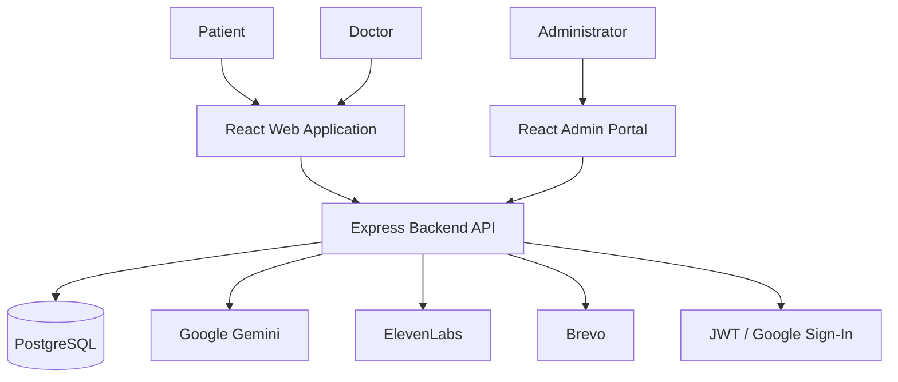

# MediTrack 🩺

### AI-Powered Digital Healthcare & Multilingual E-Prescription Platform

MediTrack is an intelligent digital healthcare platform designed to simplify doctor-patient interactions through AI-assisted consultations, multilingual e-prescriptions, secure medical records, and streamlined healthcare management.

It brings patients, doctors, and administrators together in one platform, making healthcare documentation more accessible, organized, and efficient.

## 🌟 Key Features

### 👨‍⚕️ Doctor Portal
- **AI-assisted prescription generation:** Turn consultation details into structured prescription content with the help of Google Gemini.
- **Voice-to-text consultation:** Dictate consultations using ElevenLabs Scribe, including multilingual and mixed-language speech.
- **Prescription review:** Doctors can review and confirm AI-assisted content before it is finalized.
- **QR-based patient lookup:** Find a patient's profile using their QR code.
- **Consent-based medical history:** Request access to a patient's history; access is granted only after patient approval.
- **Doctor verification:** Doctor accounts require administrator approval before prescription-related access is enabled.
- **Treatment management:** Create and manage patient treatments and prescriptions.

### 🧑‍🦽 Patient Portal
- **Personalized dashboard:** View prescriptions and healthcare information in one place.
- **Medical records vault:** Upload and manage previous reports and prescriptions, including PDF, JPG, and PNG files.
- **Multilingual prescriptions:** Read translated prescription content in a preferred language.
- **Voice playback:** Listen to prescriptions using text-to-speech.
- **Email delivery:** Receive prescription copies through email.
- **QR-based identity:** Make patient identification during consultations easier.
- **Consent controls:** Approve or deny doctor requests to access medical history.

### 🛡️ Admin Portal
- **Doctor verification:** Approve, reject, or suspend doctor accounts.
- **User management:** Manage patient and doctor accounts.
- **Treatment oversight:** Review and manage treatment records.
- **Live synchronization:** Reflect database changes in the administrative interface.
- **Audit logs:** Track sensitive actions across the platform.

### 🌐 Multilingual Experience
The application interface supports:
- English
- Hindi
- Bengali
- Marathi
- Tamil
- Telugu

Prescription translation supports:
- English
- Hindi
- Bengali
- Marathi
- Tamil
- Telugu
- Gujarati
- Kannada
- Malayalam
- Punjabi
- Urdu

Medicine names are kept in English during prescription translation to help avoid ambiguity.

## 🤖 AI & Voice Capabilities

| Technology | Purpose |
|---|---|
| Google Gemini | Consultation structuring and prescription translation |
| ElevenLabs Scribe | Speech-to-text for doctor consultations |
| ElevenLabs Text-to-Speech | Voice playback for patient prescriptions |
| Brevo | Transactional email delivery |

> **Clinical safety:** AI-generated content is assistive, not a substitute for professional medical judgment. Doctors must review and confirm prescription content before it is used for patient care.

## 🔄 How MediTrack Works

1. A patient creates an account and maintains their medical profile.
2. A doctor registers and completes the administrator verification process.
3. The doctor identifies the patient using their QR code or patient information.
4. The doctor requests access to the patient's medical history.
5. The patient reviews and approves or denies the access request.
6. The doctor records consultation details through typing or voice dictation.
7. AI assists with structuring the consultation and preparing prescription content.
8. The doctor reviews and confirms the prescription.
9. The patient can access the prescription and related records from their dashboard, including supported translations and audio playback.

## 🏗️ System Architecture



### Application Components

| Component | Responsibility |
|---|---|
| Patient and Doctor Application | Patient records, consultations, prescriptions, and account features |
| Admin Portal | User management, doctor verification, and administrative oversight |
| Backend API | Authentication, authorization, business logic, integrations, and data access |
| PostgreSQL Database | Persistent application and medical-record data |

## 🛠️ Technology Stack

**Frontend**
- React 19
- TypeScript
- Vite
- Tailwind CSS
- React Router
- i18next

**Backend**
- Node.js
- Express 5
- TypeScript
- Prisma ORM
- PostgreSQL
- JWT authentication
- Helmet
- Multer

**AI & Integrations**
- Google Gemini
- ElevenLabs
- Brevo
- Google OAuth

**Infrastructure**
- Render
- Neon PostgreSQL

## 📂 Project Structure

```text
MediTrackUsable/
├── Backend/
│   ├── prisma/
│   │   └── schema.prisma
│   ├── src/
│   ├── package.json
│   └── .env.example
├── frontend/
│   ├── src/
│   ├── public/
│   └── package.json
├── admin/
│   ├── src/
│   └── package.json
├── render.yaml
└── README.md
```

## 🚀 Live Deployment

| Service | Link |
|---|---|
| Main Application | [Open MediTrack](https://meditrack-web-k2xy-k2xy.onrender.com) |
| Admin Portal | [Open Admin Dashboard](https://meditrack-admin-k2xy-k2xy.onrender.com) |
| Backend API | [API Endpoint](https://meditrack-api-k2xy-k2xy.onrender.com) |
| API Health Check | [Check API Status](https://meditrack-api-k2xy-k2xy.onrender.com/health) |

The application is deployed using a Render Blueprint defined in [render.yaml](render.yaml). The API uses a health endpoint at `/health`; a database health endpoint is also available at `/health/db`.

**Deployment note:** The API currently uses Render's free service tier, which may spin down after inactivity. The first request after a period of inactivity can take longer while the service starts.

## 💻 Local Installation & Setup

### Prerequisites
- Node.js 22 or later
- npm
- A PostgreSQL database
- Google OAuth credentials
- API keys for the integrations you want to use

### 1. Clone the Repository

```bash
git clone https://github.com/Coderzer69/MediTrackUsable.git
cd MediTrackUsable
```

### 2. Set Up the Backend

```bash
cd Backend
npm install
```

Create a `.env` file from `.env.example` and configure the required environment variables.

```bash
npx prisma generate
npm start
```

For local development, use:

```bash
npm run dev
```

Configure your local PostgreSQL database and apply the appropriate Prisma schema or migrations before starting the application.

### 3. Set Up the Main Application

Open a new terminal from the repository root:

```bash
cd frontend
npm install
```

Create `frontend/.env`:

```env
VITE_API_URL=http://localhost:3000/api
VITE_GOOGLE_CLIENT_ID=your_google_client_id
```

Start the frontend:

```bash
npm run dev -- --port 5173
```

### 4. Set Up the Admin Portal

Open another terminal from the repository root:

```bash
cd admin
npm install
```

Create `admin/.env`:

```env
VITE_API_URL=http://localhost:3000/api
```

Start the admin portal:

```bash
npm run dev -- --port 5174
```

### Local URLs

| Service | URL |
|---|---|
| Backend API | http://localhost:3000 |
| Main Application | http://localhost:5173 |
| Admin Portal | http://localhost:5174 |

On Windows, the repository also includes `restart-all.bat` to start the local services.

## ⚙️ Environment Variables

### Backend — `Backend/.env`

| Variable | Purpose |
|---|---|
| `DATABASE_URL` | PostgreSQL connection string |
| `PORT` | Backend server port |
| `JWT_SECRET` | Secret used to sign authentication tokens |
| `GOOGLE_CLIENT_ID` | Google sign-in client ID |
| `GEMINI_API_KEY` | Google Gemini API key |
| `GEMINI_MODEL` | Gemini model configuration |
| `ELEVENLABS_API_KEY` | ElevenLabs API key |
| `ELEVENLABS_STT_MODEL` | Optional speech-to-text model configuration |
| `ELEVENLABS_TTS_MODEL` | Optional text-to-speech model configuration |
| `ELEVENLABS_VOICE_ID` | Optional voice configuration |
| `BREVO_API_KEY` | Brevo transactional email API key |
| `EMAIL_FROM_ADDRESS` | Verified sender email address |
| `EMAIL_FROM_NAME` | Optional sender display name |
| `APP_URL` | Main application URL used in email links |
| `CORS_ORIGINS` | Comma-separated list of allowed frontend origins |

### Main Application — `frontend/.env`

```env
VITE_API_URL=http://localhost:3000/api
VITE_GOOGLE_CLIENT_ID=your_google_client_id
```

### Admin Portal — `admin/.env`

```env
VITE_API_URL=http://localhost:3000/api
```

Some integrations are optional and may be unavailable when their corresponding credentials are not configured.

### Google Sign-In Setup

1. Create or select an OAuth 2.0 client in the Google Cloud Console.
2. Add your local frontend origin (for example, `http://localhost:5173`) and deployed frontend origin to **Authorized JavaScript origins**.
3. Set the client ID as `GOOGLE_CLIENT_ID` in the backend and `VITE_GOOGLE_CLIENT_ID` in the frontend.
4. If the OAuth consent screen is in Testing mode, add the accounts that need access as test users.

## 🔐 Security & Privacy

MediTrack includes security controls intended to protect account access and sensitive healthcare information:

- Password hashing using bcrypt.
- JWT-based authentication.
- Google sign-in using verified Google ID tokens.
- Role-based access control for patients, doctors, and administrators.
- Public registration restricted to supported patient and doctor roles.
- Doctor verification before prescription-related access.
- Patient-controlled consent for doctor access to medical history.
- Audit logging for sensitive actions.
- CORS restrictions and Helmet security headers.
- Authenticated access to stored patient documents and medical records.
- File validation that checks content, not only the file extension.

Never commit real API keys, database credentials, OAuth secrets, or JWT secrets to the repository. Use environment variables and rotate any credential that has been exposed.

**Healthcare disclaimer:** MediTrack is a software project and should not be treated as a substitute for professional medical advice, diagnosis, or treatment. Any real-world deployment involving patient data should undergo appropriate security, privacy, clinical, and regulatory review.

## 🤝 Contributing

Contributions, bug reports, and feature suggestions are welcome.

1. Fork the repository.
2. Create a feature branch.
3. Make your changes.
4. Test the affected application components.
5. Open a pull request with a clear description of the changes.

## 📄 License

No license file is currently specified in this repository. Unless a license is added, the project should not be assumed to be available for unrestricted reuse or redistribution.
